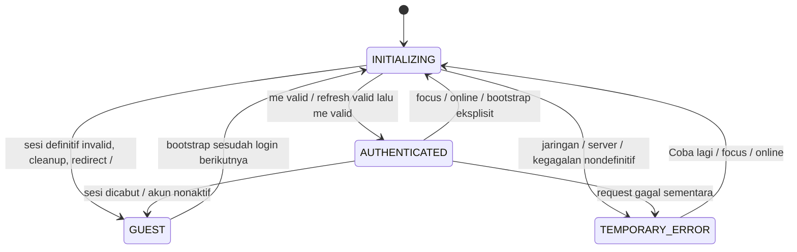

# Prompt 04 — bootstrap autentikasi frontend

## Keputusan dan audit

Audit awal: working tree bersih pada `905d0fb`, branch `main`, origin `lowhanfish/kalosara`. Prompt 01–03 tersedia; frontend belum mempunyai store/provider/query client. Versi terpasang: Next 16.4.0, React 19.3.0, TanStack Query 5.104.2, Zustand 5.0.15. `CHECKPOINT.md`, `README.md`, PDF1 (instruksi global dan Prompt 04), seluruh PDF2, `frontend/AGENTS.md`, panduan Next lokal Server and Client Components dan referensi useRouter dibaca sebelum perubahan frontend.

Runtime dibuat per AuthProvider, bukan singleton server. Cookie HttpOnly tetap otoritas backend; browser memakai `credentials: same-origin` melalui `/api/v1`. HTTP client menyediakan timeout default 10 detik per request (termasuk pembacaan body), AbortSignal, cache no-store, ApiError `{status, code, message, requestId}` dan korelasi X-Request-Id. Token auth tidak dibaca JavaScript atau dipersistenkan. CSRF diambil ke memori tepat sebelum refresh.

Bootstrap GET `/auth/me`: TOKEN_EXPIRED/UNAUTHENTICATED mencoba satu POST refresh dan satu retry. UNAUTHENTICATED juga dicoba karena browser menghapus access cookie saat expiry. Promise refresh dibagi antar-request dalam satu provider/tab; generation menahan 401 terlambat, termasuk bila refresh gagal. Endpoint auth selain me tidak diulang otomatis. Tidak ada retry TanStack tersembunyi.

401 definitif (UNAUTHENTICATED/TOKEN_EXPIRED/SESSION_REVOKED setelah refresh/retry), SESSION_REVOKED langsung, atau ACCOUNT_INACTIVE menghapus state dan seluruh query/mutation cache sebelum redirect `/` dan router.refresh. Network/timeout/502/503/409 refresh race/429 serta error nondefinitif lain menyimpan identitas dan cache, menampilkan recovery. Backend tetap memeriksa akses setiap request; RouteGuard hanya UX, menahan children selama INITIALIZING/TEMPORARY_ERROR dan menolak role yang tidak cocok.

## Diagram state

## Kontrak pemakaian modul berikutnya

- Konsumsi `useAuthRuntime().request<T>(path, {signal})`; jangan membuat fetch auth/refresh sendiri. POST bisnis harus mengirim CSRF sesuai kontrak backend; UI login/logout belum dalam scope ini.
- Semua data akun menggunakan `userQueryKey(user.id, ...parts)` dengan `enabled: status === 'AUTHENTICATED'`; teruskan signal query ke request. Jangan memakai placeholderData dari akun lain atau persist cache auth. Server state lengkap berada di TanStack Query; Zustand hanya id, role, status, error.
- Sesudah login/logout sukses, panggil dan tunggu `bootstrap()` sebelum merender area akun. Provider juga memeriksa ulang pada focus/online. Pergantian id membersihkan cache dan membatalkan query sebelum B dipublikasikan; respons dari generasi identitas lama ditolak dengan STALE_SESSION.
- Gunakan RouteGuard pada layout area protected ketika area tersebut dibuat di prompt selanjutnya. Belum ada halaman dashboard/protected baru pada Prompt 04. Jangan menaruh data privat dalam Server Component dengan mengandalkan guard client.
- Single-flight berlaku per tab, bukan lintas tab. REFRESH_RACE lintas tab diperlakukan sebagai gangguan sementara; pengguna dapat mencoba ulang dengan cookie terbaru.

## File berubah

`services/http-client.ts`, `store/auth-store.ts`, `features/auth/runtime.ts`, `features/auth/auth-provider.tsx`, `features/auth/route-guard.tsx`, `app/layout.tsx`, `tests/auth.test.cjs`, `tsconfig.test.json`, `tsconfig.json`, `eslint.config.mjs`, `package.json`, `.gitignore`, dokumentasi ini, README root dan CHECKPOINT.

## Menjalankan / migration / env

Ikuti setup backend/database pada README root. Frontend: `pnpm install --frozen-lockfile`, `pnpm dev`, buka `http://localhost:3000`. Backend APP_ORIGIN harus origin browser tersebut. Compose tetap memakai origin proxy. Tidak ada dependency, migration, secret, atau env baru. `pnpm test` mengompilasi modul ke `.test-build/` yang diabaikan Git/ESLint.

## Verifikasi otomatis

Frontend: `pnpm lint`, `pnpm typecheck`, `pnpm test` (16 kasus), `pnpm build`. Backend regresi: `npm run lint`, `npm run typecheck`, `npm test` (6 kasus), `npm run build`. Pengujian negatif memakai fetch terinjeksi tetapi menjalankan runtime, Zustand, dan QueryClient nyata:

- Reload access expired → CSRF → refresh sekali → me sekali lagi → AUTHENTICATED.
- 10 respons 401 paralel, termasuk respons terlambat: tepat satu refresh, masing-masing satu retry. Refresh 503 paralel juga tepat satu refresh; recovery dapat berhasil kemudian.
- Refresh revoked/missing/expired: cache dan identitas kosong sebelum redirect.
- Network offline, 502, 503, 409, 429: tidak logout, identitas/cache dipertahankan.
- Retry masih 401 tidak berulang; request langsung refresh tidak diretry.
- Timeout, AbortSignal yang telah dibatalkan, JSON rusak, dan requestId server.
- A → B: cache A hilang, query A yang masih berjalan tidak mengisi ulang cache; key B terpisah. Respons 401 lama milik A tidak mengeluarkan B.
- `/auth/me` melalui API client mengikuti refresh; FORBIDDEN biasa tidak mengubah sesi menjadi GUEST.

Build awal terhambat cache Turbopack pada volume macOS (AppleDouble `._*`, invalid digit) dan pembatasan socket sandbox. Hapus hanya cache generated `.next/cache/turbopack`, lalu ulangi build dengan izin socket worker. Backend supertest juga memerlukan izin socket lokal. Ini tidak memerlukan perubahan kode/dependency.

## Langkah manual untuk reviewer

Belum diklaim sebagai uji browser end-to-end. Dengan backend/database aktif, login lewat API pada browser origin yang sama (UI login belum tersedia), lalu:

1. Hapus hanya access cookie lewat DevTools dan reload; Network harus menunjukkan me 401, csrf, satu refresh, me 200.
2. Cabut refresh session melalui logout-all pada sesi lain, lalu reload; pastikan kembali ke `/` dan cache kosong.
3. Aktifkan Offline/putus backend; reload lalu pulihkan koneksi dan tekan Coba lagi. Sesi tidak diperlakukan invalid saat offline.
4. Jalankan request protected paralel setelah menghapus access cookie; amati satu POST refresh.
5. Ganti akun A ke B lalu bootstrap; periksa tidak ada data A di query cache B.

## Risiko / tertunda / status

UI login/logout, dashboard, design system Prompt 05 dan E2E browser lengkap menunggu prompt terkait. Tidak ada perubahan backend atau migrasi; test PostgreSQL Prompt 03 tidak diulang karena tidak ada perubahan DB/API. Penyempurnaan koordinasi refresh lintas tab dapat ditinjau terpisah. Status implementasi Prompt 04: SIAP REVIEW setelah seluruh gerbang otomatis lulus; berhenti untuk review manusia.
